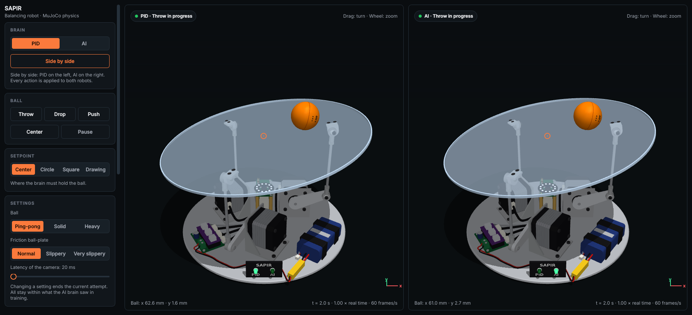
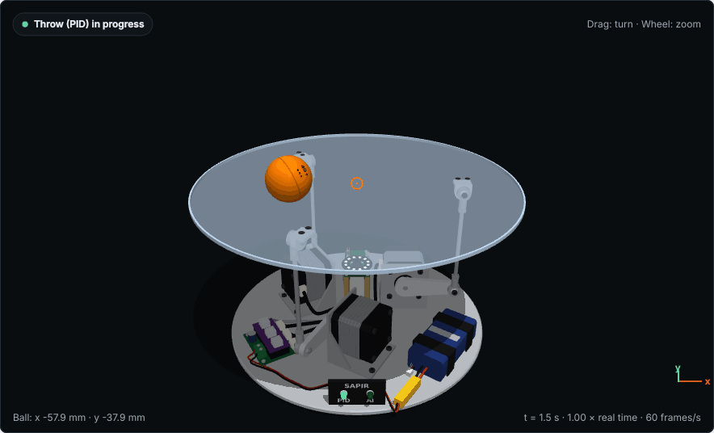
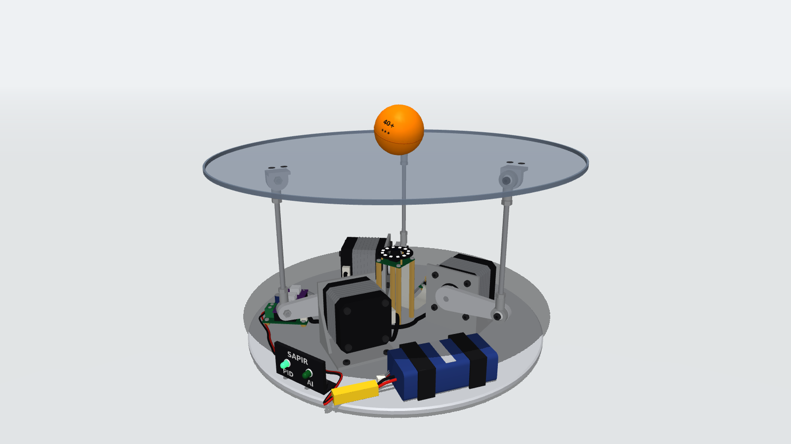

# SAPIR

**Self-balancing AI-PID Interactive Robot.** A ball-balancing robot, simulated: a plate tilted by three motors keeps a
ping-pong ball in balance, catches it when you throw it, and makes it follow a path. Two "brains" can drive it, a
classic PID controller and a small neural network (AI), and you can watch them side by side. A scientific sandbox,
not a game. (Sapir, ספיר, "sapphire", is an Israeli first name.)



## Download and install

| System | Download |
|---|---|
| Windows 10 or 11, 64-bit | [SAPIR.exe](https://github.com/DavidDayan21/ball-plate-sim/releases/latest/download/SAPIR.exe): a single file, nothing to install |
| Mac with Apple Silicon (M1 or later), macOS 14 or later | [SAPIR.dmg](https://github.com/DavidDayan21/ball-plate-sim/releases/latest/download/SAPIR.dmg) |

Every version: [Releases](https://github.com/DavidDayan21/ball-plate-sim/releases). Any recent graphics, integrated
ones included, will do (the 3D is drawn with OpenGL).

SAPIR is free, and its packages are not signed (a signature has a yearly cost): Windows and macOS warn about it the
first time it opens.

**Windows.** Double-click `SAPIR.exe`. If a blue window says "Windows protected your PC", click **More info**, then
**Run anyway**. SAPIR takes a few seconds to start: the exe unpacks itself at every launch.

**Mac.**
1. Open `SAPIR.dmg` and drag SAPIR onto the Applications folder, then open SAPIR from Applications.
2. macOS refuses to open it, as it cannot check it: close the message.
3. Open **System Settings**, then **Privacy & Security**; scroll down to Security and click **Open Anyway** next to
   SAPIR, then confirm.

Only the first time: then SAPIR opens like any other application.

## What you can do



- **Play with the ball**, with the mouse: throw it, drop it from a height, push it. The brain catches it, or not:
  while you aim, SAPIR shows the physical limit of the throw.
- **Choose the brain**, PID or AI, or put both **side by side**, a robot each: everything you do is done to both.
- **Give it a goal**: hold the ball at the center, make it follow a circle, a square, or a path you draw on the plate.
- **Change the conditions**: the ball (ping-pong, solid, heavy), the friction, the latency of the camera.
- **Watch the measurements** live, and compare the brains over your attempts: share of balls caught, time to
  stabilize, room left to the edge.
- Turn and zoom the view; light or dark theme; English or French.

## How it works



Every 20 ms, a brain receives the position of the ball, measured late by the latency of the camera, and answers
with the two tilts of the plate; three stepper motors, through three arms, tilt it. The physics (the ball rolling and
bouncing, the plate, the arms, the motors) is computed by [MuJoCo](https://mujoco.org).

- **The PID brain** is a classic controller, its gains computed by optimal control (LQR): it reacts to the error,
  its sum and its rate of change, predicts the ball despite the latency, and aims the bounce of a dropped ball.
- **The AI brain** is a small neural network (2 layers of 128 neurons), trained in simulation by imitating the PID
  brain, then left to drive alone. It runs on the computer, without internet.

Both meet the same goals, measured over many simulations: a thrown ball caught up to at least 90 % of the physical
limit, less than 2 mm of error on a circle with 60 ms of latency, back to the center in less than 2 s, and no fall
in any of the variations tested (ball, friction, latency, pushes, drops...).

The robot shown is a lab prototype built around the simulated mechanism: stepper motors, machined arms, rods with
ball joints, a camera under the transparent plate, a small computer, a battery. Building it for real remains a
distant goal: the code will then be ready.

The code, the measurements and how to run SAPIR from its sources: [technical documentation](docs/technical.md).
From the sources, in short (Python 3.13):

```powershell
pip install -r requirements-app.txt
python -m app
```

## License

No license: © 2026 DavidDayan21, all rights reserved.

The packages also hold software by others, each under its own license: Python, Qt and Qt for Python (LGPL version
3), MuJoCo (Apache 2.0), NumPy, Matplotlib, the font Inter (SIL Open Font License) and others. Their texts are in
`THIRD-PARTY-LICENSES.txt`, inside the packages and published with every version.
